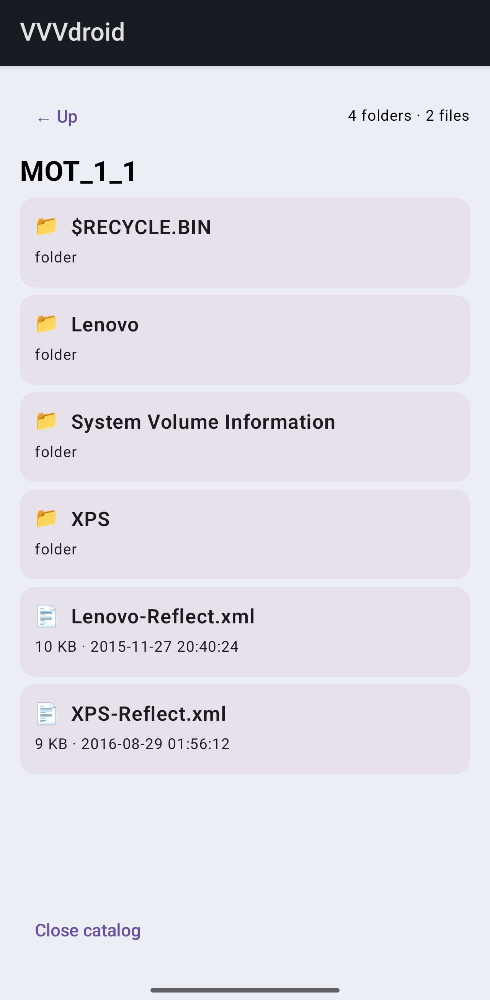

# VVVdroid

[](https://github.com/Bro-Account/VVVdroid/actions/workflows/android.yml)
[](https://github.com/Bro-Account/VVVdroid/actions/workflows/release.yml)

Read-only Android viewer for VVV 2.0 catalogs (`.vvv`, Firebird 5 ODS 13),
companion to the desktop app
[eVVVolved](https://github.com/Bro-Account/eVVVolved).

<p align="center">
  
</p>

- Opens the catalog files in place, wherever they are stored (e.g. in a
  synced folder) — multi-GB catalogs are never copied into app storage
  unless you ask for a copy.
- **Read-only guarantee:** Firebird has no per-connection read-only attach —
  even a read-only transaction lets the engine update the header page and the
  transaction inventory on attach. A database is provably immutable only when
  its header page carries the persistent read-only flag (`hdr_read_only`),
  which is the storage format of VVV 2.0. VVVdroid reads that flag straight
  from the file *before* attaching (page 0, offset 42, bit `0x20`), opens
  flagged catalogs in place, and never modifies them (measured: identical
  MD5 and mtime after open + queries; writes are refused by the engine).
- **Read-write catalogs** (older conversions, or a catalog left unflagged)
  are not opened in place by default: a dialog offers a private copy in app
  storage (original untouched) or an explicit "open in place anyway".
  Private copies live only for the session: closing the catalog deletes the
  copy, and an unclean exit is cleaned up on the next start.
- Browses one hierarchy level per screen (volumes → folders → files, like
  KeePassDroid): no desktop-style tree, system back returns one level.
- Searches file names case-insensitively across all volumes (first 500 hits)
  and shows the volume and folder path of every result.
- Uses the official Firebird 5 Android build
  (`Firebird-5.0.4.1812-0-android-embedded.aar` from the FirebirdSQL
  releases) via a thin JNI bridge.

## Install

Download `VVVdroid-<version>.apk` from the
[latest release](https://github.com/Bro-Account/VVVdroid/releases/latest) and
install it on Android 8.0 or newer. Releases are signed with the project's
own key; the `.sha256` file next to the APK verifies the download. Debug
builds from before the first release cannot be updated in place — uninstall
them once.

## Status

Working prototype: open a catalog (in place or as a private copy), list
volumes, browse folders and files, show file info, search file names across
all volumes. Planned next: catalog Android storage into a volume.

Folder listings come from the `PATHS` tree (`VOLUME_ID` + `FATHER_ID`) and
the files attached to that path (`FILES.PATH_ID`); a folder's own `FILES`
row (`PATH_FILE_ID` points to its `PATHS` entry) is excluded, so a folder
never shows up twice.

## Building

1. Provision the Firebird embedded AAR (downloads from the official
   FirebirdSQL release into `app/libs/`, not stored in git):

   ```powershell
   .\scripts\fetch-firebird-android.ps1
   ```

2. Open the project in Android Studio, or build from the command line:

   ```powershell
   .\gradlew :app:assembleDebug
   ```

JDK 25 (Gradle's daemon JVM criteria downloads it on first use), Android SDK
with platform 37, build-tools 36.0.0 and NDK 28.2.13676358 (cmake 3.22.1),
minSdk 26. The `android-build` workflow runs the same three steps on Linux
and uploads `app-debug.apk` as an artifact.

## Testing

The app accepts launch extras, which makes device/emulator cycles scriptable:

```powershell
adb shell am start -n com.vvvdroid.app/.MainActivity `
    -e vvv.catalog /sdcard/Download/_AndroidTest_ro.vvv `
    -e vvv.mode auto `      # auto | copy | inplace
    -e vvv.search windows   # optional: run a search after opening
```

`auto` asks when the catalog is read-write, `copy` always opens a private
copy, `inplace` opens the file where it is. `scripts/emulator-test.ps1`
builds, installs, pushes test catalogs and dumps the UI text — it needs an
AVD plus roughly 12 GB free disk space and 8 GB RAM (the API 37 image is
large).

## License

VVVdroid is free software: you can redistribute it and/or modify it under the
terms of the GNU General Public License as published by the Free Software
Foundation, version 2 (see [`LICENSE`](LICENSE)).

Firebird is bundled under the InterBase Public License / Initial
Developer's Public License. The full texts ship inside the APK and in this
repository at `app/src/main/assets/licenses/` (`IDPLicense.txt`,
`IPLicense.txt`).
